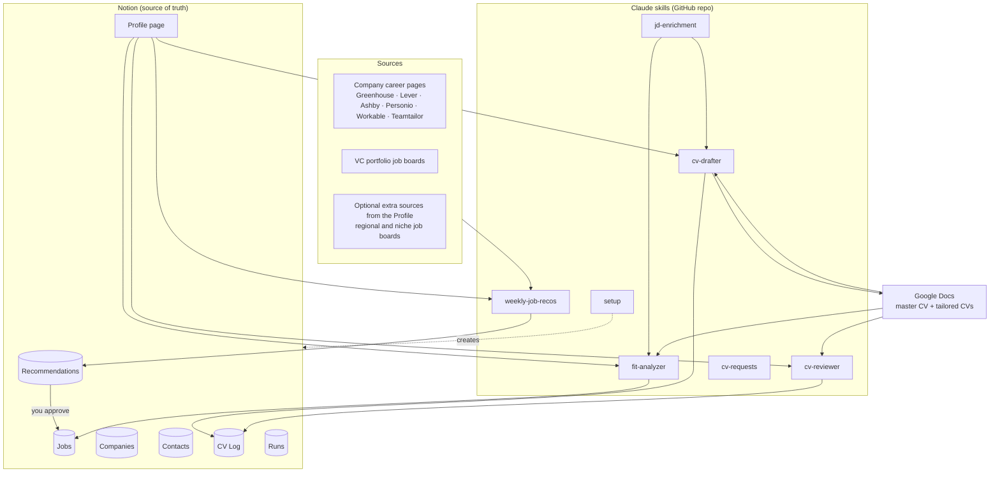
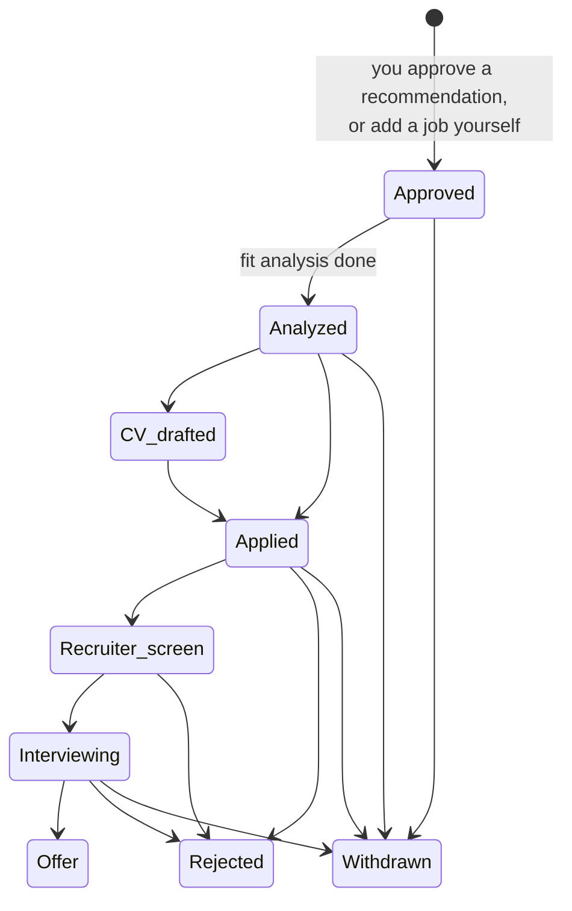

# Job Hunt OS: design doc

**Status:** v2 · **Author:** cclea-dev · **Last updated:** 2026-10-26

A personal operating system for a job search: it finds new roles each week, scores them against your CV, drafts tailored CVs, and reviews CVs line by line. Data and the day-to-day work live in Notion (or in plain files, worked on in chat). All the logic lives in Claude skills, versioned in GitHub so anyone can reuse them.

---

## 1. Goals and non-goals

**Goals**
- **One system, not separate pieces.** Search, tracking, analysis and CV work share one data model and one profile.
- **Low-touch daily use.** Approve or skip roles, see each job's fit and track the pipeline in one place: Notion, or chat with files storage.
- **Automated work, your decisions.** The weekly job recommendations, fit analyses and the CV drafts and reviews you request run on their own. The final decisions are always yours: which roles to pursue, what goes in your CV, where your applications stand, and applying.
- **Minimal maintenance.** No servers, no hosting, no app code to maintain while job hunting.

**Non-goals (v1)**
- Applying to jobs or contacting people automatically. The system never submits applications or sends messages.
- Changing a recommendation's Decision or a contact's Outreach status automatically. Only you set these. Job Status is yours too, except three automatic forward steps (see §4).
- Scraping LinkedIn directly, or using LinkedIn alert emails (tested and dropped, see D17).
- Storage other than Notion or plain files in a private repo. Others are possible (each needs one storage file, see §8), but setup isn't built for them.
- Writing cover letters (possible later).

---

## 2. Architecture



| Layer | Tool | Role |
|---|---|---|
| Storage (data) | Notion | Source of truth for recommendations, jobs, companies, contacts, CV work, run logs, and the profile/criteria |
| Views (UI) | Notion views | Reading, editing and approvals all happen in Notion (§3.8). With files storage, in chat with Claude. |
| Documents | Google Docs → PDF | Master CV and tailored copies |
| Brain | Claude skills | The six skills below. One shared profile and one shared rubric. |
| Triggers | Cloud scheduled tasks | Monday search, weekday JD enrichment and CV requests. All run without your laptop. |
| Sharing | GitHub (private → public) | Skills, setup skill, docs. No personal data. |

### Who writes what

| Data | Written by you | Written by automations |
|---|---|---|
| Recommendation **Decision**, skip reason | ✅ | ❌ |
| Job **Status** | ✅ | Only three forward steps: `Approved` (job created from your approval), `Analyzed` (fit analysis done), `CV drafted` (draft done). Never backwards, never once it's `Applied` or later (see §4) |
| Contact **Outreach status** | ✅ | ❌ |
| Contacts (all fields) | ✅ | ❌ |
| Job details (city, work mode, years, posting text, fit fields) | Optional | ✅ |
| Companies | Optional | ✅ (created and enriched automatically) |
| CV Log, Runs | — | ✅ |

---

## 3. Data model (Notion)

### 3.1 Recommendations database (the weekly inbox)

Every role the weekly job recommendations run suggests lands here first. **Only approved roles go on to Jobs.** Skipped roles stay here with their skip reason, which the search uses as learning data.

| Property | Type | Notes |
|---|---|---|
| Role | Title | |
| Company name | Text | |
| City | Select | The user's target locations, e.g. two or three cities plus Remote (country) and Remote (EU) |
| Work mode | Select | Hybrid, Remote, Onsite |
| Source | Select | Company job boards (the `site:` search), Career page; additional sources are added by name |
| Posting URL | URL | Canonical job description (prefer the company's own job page) |
| Lead URL | URL | Where it was found, when that's not the posting itself (e.g. a search hit or aggregator page) |
| Posted on / Found on | Date | |
| Min years required | Number | The lowest number the posting asks for |
| Why it matched | Text | 2–3 short bullets, shown on the approval card. Mentions salary if the posting lists it. |
| **Decision** | Select | Pending, Approved, Skipped. **Set by you only.** |
| Skip reason | Select | Too junior, Too senior, Wrong function, Location, Industry, Company, Language, Already applied (ignored by the learning), Other |
| Skip note | Text | Optional free text |
| Job | Relation → Jobs | Filled in once the job is created |

**Page body:** the Job description section: an item-by-item paraphrase of the posting, keeping every responsibility and qualification in order (see `config/job-description-format.md`). Postings disappear.

### 3.2 Jobs database (your pipeline)

| Property | Type | Notes |
|---|---|---|
| Role | Title | **You fill this in** for manual adds |
| Company | Relation → Companies | **You fill this in** for manual adds: pick the company, or type a new name and Notion creates a bare company page that JD enrichment fills in. For approved recommendations, JD enrichment links it. |
| Posting URL | URL | **You fill this in** for manual adds |
| Status | Select | See §4. Set by you, except three automatic forward steps: Approved, Analyzed, CV drafted |
| City | Select | Automatic, from the posting |
| Work mode | Select | Automatic |
| Min years required | Number | Automatic |
| Recommendation | Relation → Recommendations | Automatic, if it came from the search. That entry holds the source and lead link. Empty means you added the job yourself. |
| Fit rating | Select | High, Medium, Low |
| Fit score | Number | 0–100, for sorting |
| Analyzed on | Date | Empty means "not analyzed yet"; this is what JD enrichment looks for |
| CV draft request | Checkbox | You tick it; the CV requests run runs `cv-drafter` and unticks it when done |
| CV review request | Checkbox | You tick it; the CV requests run runs `cv-reviewer` on the CV linked in the job's CV Log entry (or the master CV if there's none) and unticks it when done. Tick again to re-run |
| CV work | Relation → CV Log | Drafts and reviews for this job |
| Contacts | Rollup (Company → Contacts) | People you know at the job's company. Contacts are linked only to their company, never to single jobs |
| Applied on | Date | You fill this in |

**Page body:** the Job description section (item-by-item paraphrase, see `config/job-description-format.md`), and the full fit analysis in readable form. The system saves the job description automatically: carried over from the recommendation, or read from the Posting URL for manual adds. Postings get taken down, and the fit analysis and CV drafter both need the text.

### 3.3 Companies

**Created and enriched automatically.** Seeded at setup from your example companies. After that, a company is added whenever an approved or manually added job names one that isn't in the database yet. You never have to fill it in.

Name, Dream company (checkbox), Industry, Stage (Scale-up / Enterprise), Careers URL, Job board system (Greenhouse / Lever / Ashby / Personio / Workable / Teamtailor / Workday / Other), Cities, Jobs (relation), Contacts (relation), Notes.

**A record, not a watchlist.** Companies show the kinds of companies you're interested in and keep their history (jobs, contacts), so you never need to delete one. Tick **Dream company** (10 at most, set by you only) for the ones whose careers pages the weekly job recommendations run should check every week; the others aren't checked, since the search is about finding companies you wouldn't think of.

### 3.4 Contacts

**Filled in by you.** Automations never write here.

| Property | Type | Options / notes |
|---|---|---|
| Name | Title | |
| Company | Relation → Companies | |
| Relationship | Select | School alum, Company alum, Event, Warm intro |
| LinkedIn URL | URL | |
| Outreach status | Select | To contact, Contacted, Replied, Had a call, Referred, No response. **Set by you only.** |
| Last contact | Date | |
| Next follow-up | Date | Shown in the Follow-ups view when due |
| Notes | Text | |

### 3.5 CV Log (drafts and reviews)

One entry per piece of CV work. Usually a job gets **either** a draft **or** a review, not both.

| Property | Type | Notes |
|---|---|---|
| Title | Title | e.g. "Review: Acme – Senior Product Manager" |
| Type | Select | CV draft, CV review |
| Job | Relation → Jobs | Empty for a review of the master CV |
| CV | URL | The Google Doc that was drafted or reviewed |
| Last run | Date | Updated when you re-run on the same CV |
| Summary | Text | One-line verdict |

**Page body:**
- **Review:** the line-by-line feedback table (see §6.4)
- **Draft:** the changelog of what was tailored and why, plus suggestions the drafter couldn't support from your CV (see §6.3)

Re-running on the same CV and job updates the existing entry instead of creating a new one.

### 3.6 Runs

One row per automated run: Type (Weekly job recommendations / JD enrichment / CV requests), Started, Sources checked, Found, Filtered out (by reason), Recommended, Searches used, Postings read, Duration (min), Model, Errors.

A **Search memory** page next to the databases lists postings the weekly job recommendations run already ruled out (date · reason · link, kept 8 weeks), so they aren't checked again. This is useful for debugging, for tuning sources, and as portfolio evidence.

### 3.7 Profile page

A single Notion page that every skill reads:
- Search criteria (moved over from `profile/search-criteria.md`)
- Master CV link
- Free-text "context about me" (what you're optimizing for this season)

### 3.8 Notion views

| View | Database | Shows |
|---|---|---|
| Inbox | Recommendations | Gallery, Decision = Pending, newest first |
| Pipeline | Jobs | Board by Status |
| High fits | Jobs | Table, Fit = High, Status = Approved or Analyzed |
| Stalled | Jobs | Status = Analyzed and Analyzed on more than 7 days ago |
| Follow-ups | Contacts | Next follow-up ≤ today |
| CV work | CV Log | By Type, newest first |

---

## 4. Status model

**Recommendations: Decision** (set by you)

`Pending` → `Approved` or `Skipped`

**Jobs: Status** (set by you)



- **Automations set three statuses, all forward steps:**
  - `Approved`: when a job is created from a recommendation you approved (in Notion, picked up by the next JD enrichment run)
  - `Analyzed`: when the fit analysis is done
  - `CV drafted`: when a tailored CV draft is done
- **Forward only.** An automation sets a status only if the job is at an earlier step (empty, `Approved` or `Analyzed`). It never moves a job backwards, and never touches a job that's `Applied` or later, `Rejected` or `Withdrawn`. Re-running an analysis on a job you've applied to doesn't reset it.
- **Everything from `Applied` onwards is yours,** as are Recommendation Decision and Contact Outreach status.
- **`Analyzed`** means the fit analysis is done.
- **`Withdrawn`** is yours to set at any point, e.g. from `Approved` when you change your mind or deprioritize a job. Withdrawn and Rejected jobs get no fit analysis.
- **CV reviews don't change Status.**
- **Automations still track their own work in their own fields** (*Analyzed on*, *CV work*), so a job you've moved on is never re-processed by mistake.

---

## 5. Triggers and schedules

All three runs are **cloud scheduled tasks**. They run on Anthropic's servers, so **your laptop can be closed or off.** Times are Europe/Madrid.

| Run | When | Does | Connectors |
|---|---|---|---|
| JD enrichment | Mon–Fri 07:00 | Runs `jd-enrichment`: creates Jobs from approved recommendations · completes manual adds · links or creates Companies · fit analysis | Notion, Google Docs |
| CV requests | Mon–Fri 08:00 | Runs `cv-requests`: CV drafts and reviews you've requested. Reads no web pages | Notion, Google Docs, Google Drive |
| Weekly job recommendations | Mon 06:00 | Runs `weekly-job-recos`. New roles go to Recommendations. | Notion, Google Docs |
| Manual | Any time, in chat | "Analyze this posting <url>", "Draft a CV for <job>", "Review my CV", "Walk me through this week's inbox" |

**Models and cost:** scheduled runs use a cheaper, faster Claude model (Sonnet). The weekly job recommendations run has a budget of about 12 web searches and 20 postings opened per run, uses `scripts/board_scan.py` to scan job-board APIs without reading whole boards, and keeps a **Search memory** page of postings already ruled out so they aren't checked again. Each run logs its searches, postings read, duration and model in Runs.

**Why time-based runs instead of event triggers:** Claude scheduled runs are time-based. A weekday run is simpler and more robust than webhooks. The cost is up to a day's delay, and a manual run covers anything urgent. The weekly job recommendations run starts at 06:00 on Mondays, an hour before JD enrichment, so roles approved early on Monday become analyzed jobs the same morning.

**Why two weekday runs:** CV drafts need Google Drive, and scheduled tasks can't block individual connector tools (such as sharing). So the run with Drive access (CV requests) never reads web pages, and the runs that read web pages (JD enrichment, weekly job recommendations) have no Drive access. See `config/safety.md`. Runs are scheduled with `CRON_TZ=Europe/Madrid`, so times stay right across daylight saving.

---

## 6. Skills

All skills read the **Profile page** and the **master CV**, so they always agree with each other about who you are.

### 6.1 `weekly-job-recos`

**Trigger:** Monday schedule, or manual.
**Output:** 3–10 new **Recommendations** with Decision = `Pending`, plus one Runs row.

1. **Load** the criteria from the Profile page, the dream companies, and the skip reasons from the last 8 weeks of Recommendations, as learning signals ("skipped 4 Customer Support ops roles → rank them lower").
2. **Gather** postings from the last 7 days. The search is **discovery-first**: its main job is finding roles and companies the user wouldn't find or think of themselves (full detail in `config/sources.md`):
   - **Job-board system search:** `site:` searches across the job-board systems' whole domains (Ashby, Greenhouse, Lever, iCIMS, Jobvite, BambooHR, SmartRecruiters, JazzHR, Workable, Workday, Taleo, Personio, Teamtailor, Recruitee, Google Docs). Role terms are generated each run: the Profile's target roles, title variants (e.g. Product Owner for Product Manager), and emerging roles that match the user's experience (e.g. AI Product Manager).
   - **Skill-based search:** roles of any title whose postings ask for what the user has done (e.g. product discovery with A/B testing).
   - **Local-language search:** role terms in a target location's language when the user speaks it (e.g. Spanish for Spanish cities).
   - **New companies:** recently funded or expanding companies in the target locations; promising ones are added to Companies as a record.
   - **Dream companies:** the careers pages of up to 10 companies you ticked.
   - **Additional sources** listed on the Profile (e.g. regional job boards). Optional.
   - Every result is opened and checked before it counts: still open, recent, and passing the filters.
3. **Dedupe** against existing Recommendations and Jobs by comparing the posting link, and the company and role names, so a role found on several sources becomes one record and nothing is suggested twice.
4. **Hard filters** from the Profile (a role is dropped if any apply). Typical ones:
   - **Function:** outside the target role families (e.g. project roles that aren't tech or digital).
   - **Location:** outside the target cities and remote rules.
   - **Seniority:** below or above the Profile's range (titles and years asked). Roles near the top of the range pass to the fit analyzer, which judges better than a cutoff.
   - **Language:** requires a language the user doesn't speak, or the posting itself is in one.
   - **Company:** outside the Profile's company rules (e.g. stage), or an agency repost that hides the employer.
   - **Salary:** **only if the posting lists one** and it's below the Profile's minimum for that location. Salary isn't stored.
5. **Rank** with a quick pre-score: role-family match, work mode (hybrid > remote > onsite), preferred industry, and learning signals. This is not the full fit analysis.
6. **Write** the top 3–10 to Recommendations with `Why it matched` and the Job description section. If fewer than 3 qualify, the search writes what qualified and notes it in the run log; it **doesn't pad** with weak matches.
7. **Log** the run.

### 6.2 `fit-analyzer`

**Trigger:** the JD enrichment run, for any job with *Analyzed on* empty and the posting text available. Can also run by hand in chat on a URL or pasted job description.
**Output:** the analysis in the page body, plus the fit fields and *Analyzed on*. Status → `Analyzed`, if the job is at an earlier step (forward only, §4).

**Method** (full detail in `config/rubric.md`, version 2)
1. **Extract the items** in the posting:
   - **Qualifications**, tagged **must-have** or **nice-to-have**, plus implied must-haves when the core of the job needs something no qualification lists.
   - **Responsibilities.** A responsibility that describes the same capability as a qualification counts **once, under qualifications** ("Covered by #N").
2. **Rate each item against the CV**, quoting the CV line:
   - **Qualifications: Match / Partial / Gap.** Partial means real but short in one way: amount (fewer years), depth (used it but didn't own it), context (a neighboring area), or a similar tool.
   - **Responsibilities: Done it / Adjacent / New.**
   - If something is likely true but missing from the CV, the analysis says *"add this to your CV if it's true"*.
3. **Severity** for Partial and Gap qualifications:
   - **Minor:** it's a nice-to-have.
   - **Moderate:** a must-have that can credibly be bridged with transferable experience or learned quickly.
   - **Critical:** a must-have that can't be bridged before or during an interview (e.g. a required language or certification, years far below the ask).
4. **Fit score: one number, the share of the job the CV covers.** Each item earns credit (Match or Done it = 1, Partial or Adjacent = 0.5, Gap or New = 0). Must-have qualifications and responsibilities count fully; nice-to-haves count half. Score = credit earned ÷ credit possible × 100.
5. **Fit rating from the score:** High 75–100 · Medium 50–74 · Low below 50. **Critical gaps cap it:** 1 critical gap → at most Medium; 2 or more → Low. The score itself is never adjusted.
6. **Role-level checks:** seniority, scope, function, domain, company, location and language, red flags.
7. **Readable output (page body):** verdict, qualifications table, responsibilities table, the score calculation, role-level checks, selling points, gaps to address.

This is the same rubric as in `config/rubric.md`, versioned and editable. The existing `job-posting-fit-analysis` skill is a reference to learn from, not a dependency.

### 6.3 `cv-drafter`

**Trigger:** you tick *CV draft request* (picked up by the next CV requests run), or ask in chat when you need it now.
**Input:** the job's fit analysis and the master CV. If the job hasn't been analyzed yet, the drafter runs `fit-analyzer` first.
**Output:** a tailored Google Doc, and a CV Log entry (Type = CV draft) linked to the job. Status → `CV drafted`, if the job is at an earlier step (forward only, §4).

0. **Ask first:** from the fit analysis, ask the user up to ~5 short questions about Partial qualifications, Adjacent responsibilities and "add this if it's true" items (in chat). Scheduled drafts don't wait: the questions go in the CV Log entry, and the draft is re-run once answered.
1. Copy the master CV into Drive at `Job Hunt/Tailored CVs/<Company> – <Role>`.
2. Tailor it using the fit analysis:
   - build the summary from the fit analysis's selling points, in order of strength, each with a concrete example
   - reorder and re-emphasize bullets toward the matched must-have qualifications and the responsibilities rated Done it
   - bridge each Partial qualification and Adjacent responsibility with the strongest truthful evidence, never stretching it into a full match
   - frame transferable experience for moderate gaps
   - trim content that's irrelevant to this role
   - where a key term from the posting truthfully describes your experience, use it naturally, in your own phrasing
3. **Hard rules**
   - **No invented claims.** The drafter never invents experience, metrics, tools or titles. Every claim must trace to the master CV.
   - **No keyword stuffing.** It doesn't overuse keywords from the job description: each key term appears at most where it genuinely fits, not repeated across bullets.
   - **No copied phrases.** It never copies exact phrases or sentences from the job description.
4. **CV Log page body:** each change and why, plus **suggestions for you**: things worth adding that the drafter couldn't support from the master CV, and gaps left open.
5. You review, edit and export to PDF yourself.

### 6.4 `cv-reviewer`

**Trigger:** ask in chat (any CV, optionally with a target job), or tick *CV review request* on a job: the next CV requests run reviews the CV linked in the job's CV Log entry (or the master CV) against it. To have a CV you tailored yourself reviewed, add it as a CV Log entry (Type = CV review, CV link, Job) and tick the box.
**Output:** a CV Log entry (Type = CV review), linked to the job if there is one. **The CV document itself is never edited.**

The page body holds:
1. **Summary** and **top 3 priorities**
2. **Line-by-line table** for summary sentences, experience bullets and skills lines:

   | # | Section | Line (quoted) | Issue type | Severity | Feedback | Suggested direction |
   |---|---|---|---|---|---|---|

   - **Issue types:** Impact · Clarity · Relevance · Keywords · Tone · Consistency · Grammar · Length
   - **Severity:** High / Medium / Low, or "—" when the line is fine
   - **Suggested direction** is guidance ("lead with the outcome; quantify the time saved"), not a rewritten bullet. You do the writing.
3. **Job titles:** one assessment of how well the titles match recruiter and applicant-tracking-system searches for the target roles. Where a past role was genuinely the same job, show the target title alongside the official one; otherwise, name the target role in the summary.
4. **Education:** reviewed as a whole; flagged only if something is unclear, unusual, or misses the job's degree qualifications.
5. **Whole-document checks:** word count (aim under 1,000), tone (positive; no clichés, buzzwords or keyword stuffing), structure, story, formatting, consistency.
6. **Fit-based guidance** (with a target job): uses the job's fit analysis to say which qualifications and responsibilities the CV can showcase better, what may be true but missing, which gaps a CV can't fix, and what the summary should lead with.

The reviewer respects the Profile's **CV preferences**: choices made on purpose, such as leaving contact details out for privacy, are never flagged.

*Why a Notion table and not Google Docs comments:* the Google Docs connector can read and edit documents but can't add comments. The table also allows sorting by severity and tracking what you've fixed.

### 6.5 `jd-enrichment` and `cv-requests`

**`jd-enrichment`** (weekdays 07:00) runs steps 1–4 in order; **`cv-requests`** (weekdays 08:00) runs steps 5–6 and never reads web pages. Each logs one Runs row. **It never touches Decision or Outreach status, and changes Status only through the forward steps in §4.**

1. **Promote approvals.** For each Recommendation with Decision = Approved and no Job yet, create the Job: copy the fields and job description, set Status = `Approved`, and link the two records. Approvals are made in Notion (or in chat, with files storage).
2. **Complete manual adds.** For jobs with only Role, Company and Posting URL filled in, read the posting and fill in City, Work mode, Min years required and the job description. If the posting can't be read, add a note at the top of the page asking you to paste the job description; each run checks again and removes the note once text is there.
3. **Link and enrich companies.** For approved recommendations, link the Company (creating it if needed). For any company with only a name, look up industry, stage, careers URL and job board system.
4. **Fit analysis** for each job with *Analyzed on* empty and the posting text available (about 8 per run at most; the rest wait a day).
5. **CV drafts** for each job with *CV draft request* ticked; untick it when done.
6. **CV reviews** for each job with *CV review request* ticked; untick it when done.

One failed job doesn't stop the run. A day with nothing to do creates no Runs row.

**Nudges** need no writes; they're computed views:
- **Stalled:** Status = `Analyzed` and *Analyzed on* more than 7 days ago. Shown in the Notion "Stalled" view.
- **Contact follow-ups:** Contacts with *Next follow-up* ≤ today.

### 6.6 `setup`

For new users and for rebuilding a setup, as a guided conversation (`skills/setup/SKILL.md`):
- asks where the data should live (Notion or files) and builds it: the Notion workspace from `config/storage/notion-workspace.md`, or a private data repo from `templates/data-repo/`
- fills in the Profile by interview, connects the master CV, CV preferences and story bank
- seeds Companies, finds each company's job board, and asks which are dream companies
- walks the user through GitHub access, the "Job Hunt" cloud environment and connectors, creates the three scheduled runs from `config/schedules.md`, and checks them with a read-only test run

---

## 7. Where you work

There's **no separate dashboard**. With Notion storage, everything happens in Notion: approve or skip in the Inbox view (Decision and Skip reason), follow your pipeline on the Pipeline board, and see nudges in the Stalled and Follow-ups views (§3.8). With files storage, you ask Claude in chat ("show this week's recommendations", "approve 1 and 3").

A Claude Artifact dashboard on top of Notion was built and dropped (D20): two places to look was less efficient than one, and it couldn't work with files storage.

---

## 8. Repo, sharing and privacy

```
job-hunt-os/
├── skills/
│   ├── weekly-job-recos/SKILL.md
│   ├── fit-analyzer/SKILL.md
│   ├── cv-drafter/SKILL.md
│   ├── cv-reviewer/SKILL.md
│   ├── jd-enrichment/SKILL.md
│   ├── cv-requests/SKILL.md
│   └── setup/SKILL.md
├── config/
│   ├── rubric.md               # fit rubric (shared)
│   ├── sources.md              # source list + how to read each
│   ├── profile.example.md      # profile format for new users
│   └── storage/
│       └── notion.md           # how each data operation works in Notion
├── docs/
│   ├── design.md               # this doc
│   ├── decisions.md            # decision log (§9), portfolio-friendly
│   └── screenshots/
└── README.md
```

- **Private repo first.** It goes public once the system works and a scrub confirms no personal data.
- **Personal data never enters the repo.** That covers the CV, criteria, and the Notion IDs that identify your workspace. The profile lives only in the user's storage (the Notion Profile page, or `profile.md` in a private data repo). Cloud runs can't read local files anyway. Skills find the workspace and its databases by name at runtime.
- **Storage files.** Skills describe *what* to do with data ("read the profile", "save the analysis to the job"). `config/storage/<option>.md` says *how* for one storage option: `notion.md` (Notion databases) and `files.md` (Markdown files in a private GitHub data repo, for people who'd rather work only in Claude). Another option means adding one storage file, not changing the skills.
- **Packaging:** a Claude Code plugin, so friends who use Claude can install it with one command. A fallback for non-Claude users (a Notion template plus copy-paste prompts) is a v2 option.

---

## 9. Decision log

| # | Decision | Alternatives considered | Why |
|---|---|---|---|
| D1 | Notion holds the data and is the UI | Notion + a Claude Artifact dashboard (tried, see D20) · Airtable · custom app (Lovable / Supabase) | Notion gives readable long-form analyses, mobile, free setup for friends and zero maintenance. |
| D2 | CVs in Google Docs → PDF | Notion / Claude Docs · .docx | Existing habit, best formatting for exporting a CV |
| D3 | CV review feedback goes in a Notion table, not in-doc comments | Google Docs comments | The connector can't comment. A table can be sorted and tracked. It also honors "don't edit my CV". |
| D4 | ~~LinkedIn alert emails are leads only~~ Superseded by D17 | Scraping LinkedIn | LinkedIn's terms and account risk; company pages are more complete and stable |
| D5 | Approvals happen in Notion (or in chat, with files storage), with skip reasons | Approving in chat | Async and mobile, and skip reasons become learning data. Chat is still an extra option. |
| D6 | Time-based weekday runs | Event triggers / webhooks | Scheduled runs are time-based. Simpler and more robust, at the cost of up to a 1-day delay. |
| D7 | Analysis runs automatically; CV work is on request | Auto-drafting for High fits | Saves effort; you choose whether a job needs a draft or a review |
| D8 | Cloud schedules | Local desktop schedules | Runs with the laptop closed. All inputs live in connected tools. |
| D9 | Salary is used to filter only when a posting lists it, and isn't stored | Salary fields on Jobs | Most postings don't list salary, so the field would mostly be empty |
| D10 | Roles near the top of the Profile's experience range pass to the fit analyzer | A hard years cutoff | Total years and relevant years differ; the analyzer judges better than a cutoff |
| D11 | Skills are storage-neutral; storage specifics live in `config/storage/` (Notion first) | Notion hard-coded into each skill | A friend can use another storage option by adding one file |
| D12 | Separate Recommendations database; only approved roles go to Jobs | Single Jobs database with an Inbox status | Keeps your pipeline clean. Skip reasons live in one place as learning data. |
| D13 | Decision and Outreach status are set by you only. Job Status is yours, except three automatic forward steps (Approved, Analyzed, CV drafted) that never move a job backwards or touch it once it's Applied or later | Status fully manual · automations advancing any status | Saves clicks on the system's own steps; everything that reflects your judgment stays yours |
| D14 | Nudges are computed views, not written flags | A run writing follow-up dates | No automation writes to your fields; nothing to clean up |
| D15 | Companies are created and enriched automatically. ~~Every company is on the watchlist~~ Revised by D21 | Manual entry · watchlist checkbox | No manual upkeep |
| D16 | CV drafts and reviews share one CV Log, linked to Jobs | Separate databases | One place for all CV work; usually a job gets one or the other |
| D17 | LinkedIn alert emails are not a source (Oct 2026) | Leads only, as in D4 · optional per user | The leads were rarely useful (broad titles, old "new" roles, often not on the company's own site), and each one cost several searches to check |
| D18 | The daily sweep is split into JD enrichment (reads the web, no Drive) and CV requests (Drive, no web), weekdays only (Oct 2026) | One daily sweep with all connectors | Scheduled tasks can't block single connector tools, so no run both reads untrusted web pages and holds Drive's share tool |
| D19 | Second storage option: Markdown files in a private GitHub data repo (Oct 2026). "Hubs" renamed to "storage", the cockpit to "Job Hunt OS Dashboard" | Notion only | Lets people work only in Claude, with no Notion account; the names say what the parts are |
| D20 | No dashboard: approvals and tracking happen in Notion (or chat, with files storage); weekly job recommendations run moved to Mon 06:00 (Oct 2026) | Keep the Artifact dashboard as an optional extra | Two places to look is less efficient than one, and the dashboard only worked with Notion. The earlier search lets Monday-morning approvals reach the 07:00 JD enrichment run |
| D21 | Companies is a record; only **Dream companies** (a checkbox, 10 at most) are checked every week (Oct 2026) | Every company on the watchlist (D15) · no company checks at all | A watchlist of 50–100 companies doesn't scale and works against discovery; the list still shows your interests and keeps history. Most roles come from searching, then scanning the boards of the companies found |

---

## 10. Risks and open questions

| Risk / question | Mitigation |
|---|---|
| **Notion and Drive connectors in cloud runs:** not yet verified that cloud scheduled tasks can use them | Test in Phase 5. Fallback: run locally on Monday mornings (needs the laptop on). |
| Source pages change or block reading | Prefer structured job boards. Each source is tested separately. Runs logs show which sources fail. Drop dead sources. |
| Postings disappear | An item-by-item paraphrase of the posting is saved when the job is found or added |
| Manual adds behind a login (e.g. a LinkedIn link) | A note at the top of the job page asks you to paste the job description; the next JD enrichment run analyzes it |
| Notion text-length limits on properties | Short property values; full detail in the page body |
| Fewer than 3 good roles in a week | The search doesn't pad; the run log shows why (which filters cut most) for tuning |
| Fit ratings drift over time | Rubric is versioned in `config/rubric.md`; ratings record the rubric version; spot-check against your own judgment for the first weeks |
| Tailored CV invents claims, stuffs keywords or copies the job description | Hard rules in §6.3; changelog for review; you approve before applying |

---

## 11. Build order

Each phase ends with something usable.

| Phase | Build | Done when |
|---|---|---|
| 0 | Repo skeleton, `.gitignore`, `config/rubric.md`, `profile.example.md` | Repo initialized (private) |
| 1 | `setup` skill → Notion databases, views, Profile page; seed Companies from the example list | Workspace exists and the Profile holds your criteria |
| 2 | `cv-reviewer` | Master CV reviewed line by line in the CV Log |
| 3 | `fit-analyzer`, with full output and fit fields | 3 real postings analyzed, and the ratings feel right to you |
| 4 | `cv-drafter` (builds on the fit analysis) | One tailored CV drafted for a real posting |
| 5 | `weekly-job-recos` (manual run, then scheduled) + check that cloud runs can use the connectors | A Monday run puts 3–10 roles in Recommendations |
| 6 | Notion Inbox view with Decision and Skip reason | You approve a week's roles in Notion |
| 7 | `jd-enrichment` and `cv-requests` scheduled | Approved jobs get created, linked and analyzed overnight |
| 8 | Notion views: Pipeline, Stalled, Follow-ups | Your pipeline and nudges are visible in Notion |
| 9 | Packaging: plugin manifest, README, screenshots, `decisions.md`, privacy scrub → public | A friend installs it successfully |
